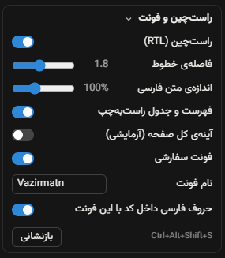

<div dir="rtl">

# Claude RTL

[English](README.md) | **فارسی**

پشتیبانی راست‌به‌چپ برای متن فارسی (و عربی)، همراه با فونت **وزیرمتن**، برای **برنامه‌ی دسکتاپ Claude در ویندوز**.

برنامه‌ی دسکتاپ Claude متن فارسیِ آمیخته با انگلیسی را درست نشان نمی‌دهد. خطی که با نام فایل شروع شود به‌هم‌ریخته دیده می‌شود، بولت‌ها سمت اشتباه قرار می‌گیرند و عنوان‌های سایدبار چپ‌چین هستند. Claude RTL با تزریق یک اسکریپت و یک فایل استایل کوچک به برنامه، این مشکل‌ها را برطرف می‌کند.

> **غیررسمی است.** این پروژه هیچ ارتباطی با Anthropic ندارد و مورد تأیید آن هم نیست. فایل‌های برنامه‌ی نصب‌شده را تغییر می‌دهد (بخش [چطور کار می‌کند](#چطور-کار-می‌کند) را ببینید). مسئولیت استفاده با خودتان است، و هر وقت بخواهید می‌توانید تغییرات را برگردانید.

## امکانات

- **فونت وزیرمتن در همه‌جای برنامه**، یا هر فونت دیگری که نصب کرده‌اید. کد، فرمول و آیکن‌ها فونت خودشان را نگه می‌دارند.
- **جهت درست برای هر پاراگراف.** پاراگراف فارسی راست‌به‌چپ و پاراگراف انگلیسی چپ‌به‌راست نمایش داده می‌شود؛ در پاسخ‌ها، در پیام‌های خودتان و در کادر نوشتن.
- **تشخیص هوشمند.** خط فارسی‌ای که با نام فایل، مسیر، لینک یا یک کلمه‌ی انگلیسی شروع شود (مثل `Patch.ps1: اسکریپت اصلی`) هم فارسی تشخیص داده می‌شود.
- **لیست و جدول.** بولت لیست‌های فارسی سمت راست است و ستون اول جدول‌های فارسی هم سمت راست قرار می‌گیرد.
- **سایدبار.** عنوان سشن‌های فارسی راست‌چین می‌شوند، و آیکن‌ها و منوی `⋯` هر ردیف سر جای خودشان می‌مانند.
- **کد و فرمول** همیشه چپ‌به‌راست می‌مانند.
- **پنل تنظیمات.** کارت «راست‌چین و فونت» در پنل کناری Claude Code (زیر Environment، Context، Connectors و Changes) همه‌چیز را زنده تغییر می‌دهد: روشن/خاموش کردن RTL، فاصله‌ی خطوط، اندازه‌ی متن فارسی، فهرست و جدول، آینه‌ی کل صفحه، فونت و نام آن، و حروف فارسی داخل کد. در جاهای دیگر با **`Ctrl+Alt+Shift+S`** باز می‌شود.
- **قابل اجرای دوباره.** بعد از هر آپدیت Claude دوباره اجرایش کنید. اجرای چندباره تغییرات را روی هم انباشته نمی‌کند.
- **برگشت‌پذیر.** با یک دستور (یا فایل `uninstall.cmd`) فایل‌های اصلی برمی‌گردند.

## پیش‌نیازها

| | |
|---|---|
| سیستم‌عامل | ویندوز ۱۰ یا ۱۱ |
| Claude | نسخه‌ی دسکتاپ از Microsoft Store یا نصب‌کننده‌ی MSIX (حالت پیش‌فرض در ویندوز) |
| [Node.js](https://nodejs.org) | نسخه‌ی ۱۸ یا جدیدتر، در `PATH` |
| فونت | [وزیرمتن](https://github.com/rastikerdar/vazirmatn/releases)، نصب‌شده در ویندوز (فایل‌های `.ttf` ثابت) |
| دسترسی | Administrator (برنامه در پوشه‌ی محافظت‌شده‌ی `WindowsApps` نصب شده است) |

## نصب

۱. [Node.js](https://nodejs.org) و فونت [وزیرمتن](https://github.com/rastikerdar/vazirmatn/releases) را نصب کنید (فایل‌های `.ttf` را انتخاب کنید ← راست‌کلیک ← *Install*).

۲. این مخزن را دانلود کنید (**Code ← Download ZIP**) و هر جایی که خواستید از حالت فشرده خارج کنید.

۳. روی **`install.cmd`** دوبار کلیک کنید و درخواست دسترسی Administrator را تأیید کنید.

اسکریپت Claude را می‌بندد، تغییرات را اعمال می‌کند و دوباره بازش می‌کند. وقتی پیام `Patched` را دیدید، کار تمام است.

**بعد از هر آپدیت Claude، دوباره `install.cmd` را اجرا کنید.** هر آپدیت یک نسخه‌ی تازه و دست‌نخورده از برنامه نصب می‌کند.

### اجرا از PowerShell

این دستورها را در یک PowerShell **با دسترسی Administrator** اجرا کنید که خارج از Claude باز شده باشد:

</div>

```powershell
powershell -ExecutionPolicy Bypass -File .\Patch-ClaudeRTL.ps1
```

<div dir="rtl">

| گزینه | کار |
|---|---|
| `-Font "Sahel"` | به‌جای وزیرمتن، از فونت نصب‌شده‌ی دیگری استفاده می‌کند |
| `-Mode full` | *آزمایشی.* علاوه بر متن، کل چیدمان را هم آینه می‌کند (سایدبار سمت راست) |
| `-DryRun` | فایل تغییریافته را فقط در `%TEMP%` می‌سازد؛ چیزی نصب نمی‌شود و دسترسی Administrator هم لازم نیست |
| `-Restore` | فایل‌های اصلی را برمی‌گرداند |
| `-NoRestart` | بعد از اتمام کار، Claude را دوباره باز نمی‌کند |

`install.cmd` آرگومان‌هایش را به اسکریپت می‌دهد، مثلاً `install.cmd -Font "Sahel"`.

## حذف

روی **`uninstall.cmd`** دوبار کلیک کنید، یا این دستور را اجرا کنید:

</div>

```powershell
powershell -ExecutionPolicy Bypass -File .\Patch-ClaudeRTL.ps1 -Restore
```

<div dir="rtl">

آپدیت Claude هم تغییرات را حذف می‌کند، چون یک نسخه‌ی تازه نصب می‌کند.

## تنظیمات

کارت تنظیمات پایین پنل کناری سشن در Claude Code ظاهر می‌شود. اگر آنجا نبود (صفحه‌ی دیگری باز است، یا Claude ساختار پنل را عوض کرده)، با **`Ctrl+Alt+Shift+S`** یک نسخه‌ی شناور باز می‌شود؛ `Esc` آن را می‌بندد.

<p align="center"></p>

| تنظیم | پیش‌فرض | کارش |
|---|---|---|
| راست‌چین (RTL) | روشن | جهت هر پاراگراف، فهرست، جدول و عنوان‌های سایدبار. خاموشش کنید تا چیدمان خود Claude برگردد؛ فونت جداگانه تنظیم می‌شود. |
| فاصله‌ی خطوط | ۱.۹ | فاصله‌ی خطوط پاراگراف‌ها، آیتم‌های فهرست و خانه‌های جدول فارسی. |
| اندازه‌ی متن فارسی | ۱۰۰٪ | اندازه‌ی بلوک‌های فارسی در پاسخ‌ها، نسبت به متن اطراف. |
| فهرست و جدول راست‌به‌چپ | روشن | بولت و ستون اول فهرست‌ها و جدول‌های فارسی سمت راست. |
| آینه‌ی کل صفحه | `-Mode` | قرینه کردن کل چیدمان (آزمایشی، همان `-Mode full`). |
| فونت سفارشی | روشن | فونت در همه‌جا به جز کد، فرمول و آیکن‌ها. |
| نام فونت | `-Font` | هر فونت نصب‌شده (حروف، عدد، فاصله و خط تیره). همزمان با تایپ اعمال می‌شود. |
| حروف فارسی داخل کد | روشن | حروف فارسی در بلوک‌های کد با همین فونت نمایش داده می‌شوند، نه فونت پیش‌فرض سیستم. |

انتخاب‌ها داخل خود برنامه (`localStorage`) ذخیره می‌شوند و بعد از بستن برنامه و patch دوباره باقی می‌مانند. فقط مقدارهای تغییرکرده ذخیره می‌شوند، پس `-Font` و `-Mode` همچنان پیش‌فرض‌ها را تعیین می‌کنند. دکمه‌ی **بازنشانی** به همان پیش‌فرض‌ها برمی‌گرداند.

## چطور کار می‌کند

برنامه‌ی دسکتاپ Claude با [Electron](https://www.electronjs.org/) ساخته شده است. کدش در فایل `resources\app.asar` قرار دارد و هر پنجره پیش از بارگذاری صفحه، *اسکریپت‌های preload* را از همین فایل اجرا می‌کند.

۱. **کد تزریقی.** فایل [`payload/claude-rtl.js`](payload/claude-rtl.js) به ابتدای سه اسکریپت preload (`mainView.js`، `mainWindow.js` و `quickWindow.js`) اضافه می‌شود. این فایل یک استایل اضافه می‌کند (فونت، `unicode-bidi: plaintext` برای هر پاراگراف، و چپ‌به‌راست ماندن کد) و یک `MutationObserver` که هر جا قانون «اولین حرف» مرورگر اشتباه کند، `dir` را درست تنظیم می‌کند. `dir`ای را که خود claude.ai گذاشته باشد تغییر نمی‌دهد، مگر در یک بلوک متنی که تشخیص خودش به‌وضوح با آن مخالف باشد.

۲. **بایگانی برنامه.** ابزار [`tools/asar-inject.js`](tools/asar-inject.js) فایل `app.asar` را با کد تزریقی بازنویسی می‌کند. وابستگی خارجی ندارد، بقیه‌ی فایل‌ها را بایت‌به‌بایت دست‌نخورده نگه می‌دارد و hash یکپارچگی هر فایل را به‌روز می‌کند.

۳. **hash یکپارچگی.** Electron بررسی می‌کند که `app.asar` با یک hash از نوع SHA-256 که داخل `claude.exe` ذخیره شده مطابقت داشته باشد. ابزار [`tools/exe-hash.js`](tools/exe-hash.js) همان رشته‌ی ۶۴ کاراکتری را در جای خودش عوض می‌کند. اندازه‌ی فایل تغییر نمی‌کند و بررسی یکپارچگی Electron **فعال می‌ماند**. اگر hash قدیمی پیدا نشود، اسکریپت قبل از هر تغییری متوقف می‌شود.

۴. **نصب.** اسکریپت [`Patch-ClaudeRTL.ps1`](Patch-ClaudeRTL.ps1) مالکیت فایل‌هایی را که باید بنویسد می‌گیرد، از فایل‌های اصلی با پسوند `*.fa-orig` نسخه‌ی پشتیبان می‌سازد، فایل‌های جدید را جایگزین می‌کند و Claude را دوباره باز می‌کند.

این‌ها چیزهایی است که باید بدانید:

- `claude.exe` تغییر می‌کند، پس **امضای دیجیتالش دیگر معتبر نیست**. ویندوز همچنان اجرایش می‌کند. ممکن است سرویس Cowork (`cowork-svc`) با برنامه‌ی تغییریافته کار نکند؛ اگر از Cowork استفاده می‌کنید، آن را امتحان کنید و در صورت نیاز تغییرات را حذف کنید.
- اسکریپت **مالکیت** پوشه‌ی برنامه‌ی Claude و فایل‌های `app.asar` و `claude.exe` را به گروه Administrators می‌دهد تا بتواند در آن‌ها بنویسد.
- فقط **برنامه‌ی دسکتاپ** Claude بسته می‌شود؛ پردازش‌های Claude Code (CLI) دست‌نخورده می‌مانند.
- اگر از قبل patch راست‌چین دیگری اعمال شده باشد، فایل‌های `.bak` آن به‌عنوان نسخه‌ی تمیز استفاده می‌شوند.

## رفع مشکل

| مشکل | راه حل |
|---|---|
| `Run this from an elevated PowerShell` | از `install.cmd` استفاده کنید، یا روی PowerShell راست‌کلیک کنید ← *Run as administrator*. |
| `Node.js is required` | Node.js نسخه‌ی ۱۸ یا جدیدتر را نصب کنید و یک پنجره‌ی **جدید** باز کنید. |
| `Font ... does not look installed` | فونت را برای کاربر خودتان یا همه‌ی کاربران نصب کنید و دوباره اجرا کنید. |
| `claude.exe does not contain the expected asar hash` | این نسخه از Claude یکپارچگی را به روش دیگری ذخیره می‌کند. هیچ تغییری انجام نشده است. لطفاً با ذکر نسخه‌ی Claude یک [issue](../../issues) باز کنید. |
| `Claude did not close` | Claude را از system tray ببندید و دوباره اجرا کنید. |
| Claude بعد از patch باز نمی‌شود | `uninstall.cmd` را اجرا کنید و یک [issue](../../issues) باز کنید. |
| کارت تنظیمات در پنل کناری نیست | با **`Ctrl+Alt+Shift+S`** پنل شناور را باز کنید. گزارش `Ctrl+Alt+Shift+D` (ردیف بعد) می‌گوید پنل کناری پیدا شده یا نه؛ آن را به issue پیوست کنید. |
| چیزی در رابط کاربری درست نیست | داخل Claude کلیدهای **`Ctrl+Alt+Shift+D`** را بزنید. یک گزارش JSON از عناصر فارسی رابط (ساختار، استایل‌ها، و اینکه هر `dir` را Claude گذاشته یا این patch) در کلیپ‌بورد کپی می‌شود. آن را همراه یک اسکرین‌شات به issue پیوست کنید. *این گزارش متن همان عناصر را دارد، مثلاً عنوان سشن‌ها؛ قبل از ارسال آن را بازبینی کنید.* |

## توسعه

</div>

```powershell
npm test                                       # tests for the patch tools (Node built-in runner, no dependencies)
.\Patch-ClaudeRTL.ps1 -DryRun                  # build the patched asar without installing it
```

<div dir="rtl">

ساختار پروژه:

</div>

```
Patch-ClaudeRTL.ps1     install / restore script
install.cmd             double-click launcher (asks for admin)
uninstall.cmd           double-click restore
payload/claude-rtl.js   the CSS + JS injected into Claude
tools/asar-inject.js    rewrites app.asar with the payload
tools/exe-hash.js       updates the asar hash inside claude.exe
tools/asar-util.js      small helpers for the script
test/                   npm test
docs/                   README images
.github/workflows/      release automation
```

<div dir="rtl">

فایل‌های `.ps1` و `.cmd` و کد تزریقی باید **فقط ASCII** باشند (حروف غیر ASCII را به شکل `\u` بنویسید)، چون PowerShell 5.1 ویندوز فایل‌های غیر ASCII بدون BOM را اشتباه می‌خواند. یک تست این را بررسی می‌کند.

مشارکت شما خوشحالمان می‌کند. برای مشکلات رابط کاربری، لطفاً گزارش `Ctrl+Alt+Shift+D` را هم بفرستید، چون ساختار HTML سایت claude.ai مرتب تغییر می‌کند.

## سپاسگزاری

- فونت [وزیرمتن](https://github.com/rastikerdar/vazirmatn) اثر صابر راستی‌کردار (مجوز SIL Open Font License). این فونت همراه پروژه نیست و باید جداگانه نصب شود.
- Claude محصول شرکت Anthropic است. این پروژه فقط نحوه‌ی نمایش متن در برنامه‌ی دسکتاپ را روی کامپیوتر خودتان تغییر می‌دهد.

## مجوز

[MIT](LICENSE)

</div>
